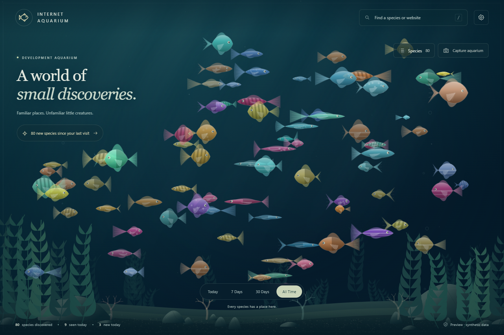

# Internet Aquarium

A living, local-only aquarium made from the places you explore online. Each hostname becomes a deterministic, illustrated fish. Returning visits grow it; time spent browsing adds maturity; recent visitors swim more actively. Older fish settle into calmer water and stay in your collection.

Built with Manifest V3, React, strict TypeScript, Vite, and Canvas 2D. No backend or runtime network access is needed.



## Installing locally

The generated **`dist`** folder is the complete unpacked extension.

1. Build using the commands below (or use the already generated `dist`).
2. Open `chrome://extensions` in Chrome or `edge://extensions` in Edge.
3. Enable **Developer mode**.
4. Choose **Load unpacked**, then select this project's **`dist`** folder, not the project root.
5. The welcome page opens. Read the explanation, select **Start my aquarium**, then allow history and tab permissions in Chrome's dialog.
6. Browse normally. Open the toolbar popup and select **Open aquarium**.

Existing browsing history is **not imported**. New history events start contributing after onboarding. Reload the unpacked extension after rebuilding. Keep the folder in place; moving it can change an unpacked extension's identity and its storage. Export before moving it.

## Development

Use Node.js 22.12+ (Node 24 works) and pnpm. Dependencies are recorded in `pnpm-lock.yaml`.

```powershell
pnpm install --frozen-lockfile
pnpm dev
pnpm test
pnpm build
```

Open the local URL printed by Vite. This is a clearly labelled development aquarium with **80 synthetic records** and separate localStorage. It cannot track real browsing. Settings includes 80 / 500 / 2,000-record fixtures. Fake records are never automatically added to the real extension.

This Windows workspace also includes a runner that finds either your installed pnpm or the bundled Codex pnpm used during development:

```powershell
.\scripts\project.ps1 install
.\scripts\project.ps1 dev
.\scripts\project.ps1 test
.\scripts\project.ps1 build
```

Production build: `pnpm build` checks TypeScript, bundles local JS/CSS, copies icons, and writes `dist/manifest.json`. Opening `dist/index.html` as an ordinary web page is not supported; load `dist` as an extension.

## How it works

```text
New browser history events + focused active tab
    → normalized hostname summaries in chrome.storage.local
    → stable FNV-1a hash + seeded generator
    → fish body / fins / tail / colour / patterns / species name
    → bounded growth + maturity + recency
    → cached Canvas artwork and spatial-grid simulation
```

### Tracking and active time

- `chrome.history.onVisited` contributes one recorded visit per event. No history search or backfill is used by the extension. Counts are extension observations, not Chrome's lifetime counts.
- Only HTTP(S) URLs are accepted. Leading `www.`, hostname case and trailing dots are normalized. Meaningful subdomains, such as `docs.google.com`, remain separate. Localhost, loopback and internal browser/extension/file URLs are excluded. Other intranet/IP sites may be recorded if they are normal HTTP(S) sites.
- URLs exist transiently in the browser event handler. Paths, queries, fragments and titles are discarded before persistence.
- Active time is accumulated only for an already discovered domain when a normal website tab is active in a focused, non-minimized browser window. Tab, URL and window changes close the previous interval. The aquarium itself is excluded.
- A 30-second Chrome alarm checkpoints time to local storage. A small `chrome.storage.session` checkpoint lets the worker resume after suspension. A full browser startup clears the checkpoint, so closed-browser time is not counted.
- Gaps longer than 90 seconds are discarded to avoid counting sleep as activity. The final interval can be lost on abrupt exit. Timing is approximate; it measures focused-tab time, not attention, input activity or exact screen time. An unattended but focused browser can still count time.
- Tracking visits and estimating active time can be toggled independently. Turning visits off prevents discovery; time can continue accumulating for known domains if its separate toggle is on.
- All mutations run through a serialized background-worker queue to avoid writes from simultaneous tabs/settings overwriting each other.

### Fish and environment

- Stable domain hash and seeded random generation determine permanent traits. Eight body families, six tail types, three fin styles, seven patterns, colours, fictional names and rare cosmetic glow/translucency provide variety.
- A small bundled category map subtly influences body families and behaviour. Unknown sites use `Other`. No classification request leaves the device.
- Size follows `min(2, 0.6 + log1p(visits) × 0.15 + log1p(activeMinutes) × 0.07)`. Diminishing returns prevent unlimited growth.
- Maturity follows accumulated active time separately and adds fin/tail detail without changing species.
- Recency smoothly decays activity toward a calm floor. It never kills fish or implies poor health.
- A spatial grid bounds neighbour checks at 18 per fish. Separation, weak alignment/cohesion, wander, smooth boundary steering and trait-dependent cursor response keep movement varied. Fish artwork is cached; React does not render individual swimming fish.
- Up to 500 fish swim at once (100/250 are selectable). Priority is selected fish, pinned fish, then recent visitors. All records remain in the searchable, paginated directory. Selecting an unrendered species brings it into the simulation. Large populations use smaller presentation scales.
- Pseudo-depth changes scale, opacity and speed. Plants, stones and coral gain detail with population, category variety and accumulated activity. Local time changes water lighting; rare fish glow at night.
- Hidden pages suspend animation. Reduced-motion preferences pause motion. Low measured frame rates reduce bubbles and particles.

## Using your aquarium

- Click a fish for its field notes; hover for a compact identification label. Keyboard users can select through Search or Species. `/` focuses Search; Escape closes panels.
- Search by hostname or generated name. Directory sorting supports recently seen, most visited, newest and alphabetical, plus a pinned-only filter.
- Pin a fish to prioritize it and gently favour central placement. Pinning changes no browsing statistics.
- Today / 7 Days / 30 Days / All Time change brightness emphasis; they never delete fish. Today starts at local midnight; other periods use rolling days and the latest observed visit.
- Capture aquarium exports the Canvas scene as PNG. UI panels and private domain labels are deliberately omitted, even when a details panel is open.
- Export aquarium data saves only extension-owned JSON, including domain summaries, settings and pins. Treat it as private browsing metadata.
- Import checks version, schema, types, dates, identity seeds and duplicate domains (maximum 20,000 records / 10 MB file). Review the replacement confirmation first; export a backup to retain the old aquarium.
- Reset requires confirmation, removes extension-owned data/checkpoints, and returns to onboarding. It never clears or edits Chrome history. Previously granted permissions remain granted by Chrome, but recording stays off until onboarding is completed again.

## Privacy and permissions

**Internet Aquarium processes browsing metadata locally. Browsing data is never uploaded. There is no cloud backend, analytics service, or account system.**

Stored per domain: hostname, first/last discovery timestamps, recorded visit count, approximate active seconds, deterministic seed, category, creation timestamp, pin. Settings, onboarding status and last aquarium opening are also local. There is no per-page log, favicon fetching, page-title storage, content script, form inspection, remote font or telemetry.

The extension has no host permissions and its production Content Security Policy blocks connections with `connect-src 'none'`. Incognito access is disabled in the manifest. Local browser storage is not a separately encrypted vault; people with access to your browser profile or exported JSON may read it.

| Permission | When | Purpose |
| --- | --- | --- |
| `storage` | Installation | Persist aquarium summaries/settings in local storage; temporary clock in session storage. |
| `alarms` | Installation | Checkpoint approximate active time while the Manifest V3 worker may sleep. |
| `history` | Optional, after the welcome explanation | Receive new visit events. Chrome's grant is broader than this read-only use; the extension never calls history mutation APIs. |
| `tabs` | Optional, after the welcome explanation | Read the active tab URL for timing and the popup's current-site fish. Page contents are never accessed. |

No cookies, downloads, clipboard, debugger, browsingData, webRequest, favicon or unlimitedStorage permissions. File exports use ordinary local Blob downloads.

Official API references: [history](https://developer.chrome.com/docs/extensions/reference/api/history), [permissions](https://developer.chrome.com/docs/extensions/reference/api/permissions), [alarms](https://developer.chrome.com/docs/extensions/reference/api/alarms).

## Architecture

```text
src/background/           Browser events, serialized writes, timing checkpoints
src/shared/               Models, categories/normalization, deterministic fish logic
src/shared/storage/       Validation, repository, UI message client
src/aquarium/fish/        Procedural body/fin/tail texture painter
src/aquarium/simulation/  Bounded spatial-grid movement
src/aquarium/environment/ Cached layered tank artwork
src/aquarium/             Canvas lifecycle, selection, rendering, screenshots
src/dashboard/            React controls, onboarding, directory, details, settings
src/popup/                Current-site fish and a small daily summary
tests/                   Determinism, growth, normalization, persistence, timing
scripts/                 Repeatable browser and extension verification
```

## Verification

```powershell
pnpm test
pnpm build
pnpm test:browser
pnpm test:extension
```

The browser script starts and stops its own loopback Vite server, uses synthetic data, and saves screenshots and a JSON report under ignored `test-results/`. It defaults to the standard Windows Chrome path; set `CHROME_PATH` to override. Set `AQUARIUM_URL` to test an already running Vite server instead.

The extension script uses an isolated profile under ignored `.browser-test-profile/`, never your normal Chrome profile. It loads the actual production build and checks onboarding and the lack of pre-consent tracking. Native permission-dialog acceptance/denial requires a manual check. For automated tracking checks, it copies `dist` under `test-results/` and changes **only that test copy's manifest** to pre-grant the optional permissions. All worker/UI bundles remain identical. Test web navigations are fulfilled locally; no real browsing history is used. The restart check closes Chrome, reopens the same isolated profile, reloads the unpacked test extension through CDP, and compares saved data.

See [VALIDATION.md](VALIDATION.md) for measured results and remaining manual checks. Browser tests require a recent Chrome supporting the extension debugging API. They do not publish, install in your daily profile, or contact visited domains.

## V1 boundaries and next steps

- Finish the native Chrome allow/deny/retry flow check and a short everyday browsing trial in your own profile. Check minimization, focus changes to another app, suspend/resume and a normal manual Chrome restart on your setup.
- Performance depends on hardware, resolution and device pixel ratio; a universal 60 FPS is not guaranteed. Lower the fish limit if needed. The target is 500 simulated fish and thousands of retained records, not simultaneous simulation of every domain.
- This version stores first/last timestamps and aggregates, not a historical timeline. Filters use last-seen timestamps; they cannot reconstruct past fish size.
- Long-term appearance is implemented from saved aggregates and synthetic old records, but a multi-day real-world soak is still needed.
- Storage has Chrome's normal local quota; errors are surfaced rather than silently dropping historical fish. Extremely large exports should be backed up before further collection.
- No accounts, sync, productivity scores, feeding, deaths, payments or store publishing are included.
